# 解析覆盖 vs 固定 N 倍采样：细线 / 斜线 / 相交路径对照实验

纯 Go（仅标准库）实现的覆盖率光栅化实验台。针对“2 倍 / 3 倍覆盖率在细线、斜线和
相交路径上的问题被模糊掩盖”的反馈，这里不使用任何模糊来伪造抗锯齿，而是并列实现两套
可核验的覆盖率后端，并额外给出一个“先硬画再高斯模糊”的反面基线：

- **解析覆盖（analytic）**：把每条轮廓表示成多边形，用 Sutherland–Hodgman 将多边形
  裁剪到每个像素方块，再用鞋带公式求交面积，得到该像素的精确盒滤波覆盖率。
- **固定 N 倍采样（`ssN`）**：每像素 `N×N` 个规则网格点做多边形包含测试，
  `coverage = 命中数 / N²`。重点产物是 `ss2`（2×2 / 4 采样）与 `ss3`（3×3 / 9 采样），
  同时保留 `ss1/ss4/ss8` 的数据用于观察收敛。
- **模糊基线（blur）**：先做单采样硬边渲染，再对预乘 RGBA 做 σ=1.15 的可分离高斯模糊，
  用来量化“用模糊掩盖误差”到底会向外漏多少颜色。它只作为对照，不是本方案。

坐标系约定：像素 `(x,y)` 覆盖连续方块 `[x,x+1]×[y,y+1]`，像素中心为 `(x+0.5,y+0.5)`。

## 运行

```bash
go run .                 # 生成全部 PNG / CSV / summary.json 到 ./out
go run . -out /tmp/o     # 也可以换输出目录
go run ./cmd/coverlab    # 等价入口
go test -count=1 ./...   # 几何、连续性、不染色、收敛性与端到端产物测试
```

不需要 `go get`，`go.mod` 零依赖，不会下载或安装任何组件。

## 产物导航

```text
out/
  summary.json                 # 全部误差、连续性、染色与检查结论
  coverage/<scene>__<method>.png   # 覆盖率图（放大 + 网格 + 每格数值）
  closeup/<scene>__<method>.png    # 边缘特写（彩色放大 + 像素网格）
  heatmap/<scene>__<method>_error.png # |method - analytic| 误差热图 + 色标
  stain/segregate__red_<method>.png   # “去掉红色图层前后”的差异热图
  sweep/continuity_chart.png       # 亚像素平移：固定像素覆盖率曲线
  sweep/continuity_strip.png       # 0.1px 步进的逐条特写胶片
  sweep/sweep.csv                  # 对应的原始数值表
```

场景：`thin_h`（0.52px 细线）、`diagonal`（45° 细线）、`cross`（两条相交彩色斜线）、
`near_diag`（两条相距约 1.7px、互不相交的平行斜线）、`segregate`（三条互不相交的彩色竖线，
其中 `(4,7)` 是红/蓝之间的纯背景保护像素）。

## 1. 细线移动零点几个像素时，亮度连续变化

一条宽 `0.52px` 的水平线，中心从 `y=4.5+dy` 以 `0.1px` 步进平移，追踪固定像素 `(12,4)`
的覆盖率（黑线下白底，灰度 `gray=255*(1-c)`）：

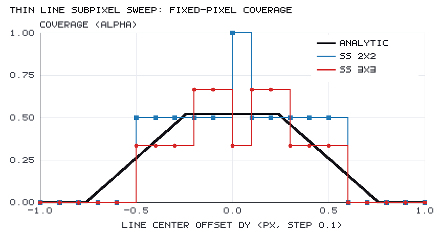

`out/sweep/sweep.csv` 的关键行：

| dy | analytic | ss2 (2×2) | ss3 (3×3) |
|---:|---:|---:|---:|
| -0.4 | 0.36 | 0.50 | 0.333 |
| -0.2 | 0.52 | 0.50 | 0.667 |
|  0.0 | 0.52 | **1.00** | 0.333 |
| +0.1 | 0.52 | 0.50 | 0.667 |
| +0.2 | 0.52 | 0.50 | 0.667 |
| +0.4 | 0.36 | 0.50 | 0.333 |

相邻 `0.1px` 步进的最大覆盖率跳变（`summary.json -> sweep.maxAdjacentJump`）：

- analytic：**0.100**（恰好满足覆盖率关于平移的 Lipschitz 常数 1，连续且无跳变）
- ss2：**0.500**（水平线上一整行采样点同时翻转，亮度台阶是 `1/2`）
- ss3：**0.333**（台阶 `1/3`，且在解析解为 `0.52` 的平台区上下抖动）

更细的 `0.05px` 扫描测试断言解析覆盖最大跳变不超过 `0.05`（见
`cover/coverage_test.go` 的 `TestAnalyticThinLineContinuity`）。胶片图里可以直接看到
解析方案把墨量连续地分配到相邻两行，而采样方案是成块跳变，SS2 甚至在 `dy=0` 时把
真实覆盖率 `0.52` 的像素报成满覆盖 `1.00`：

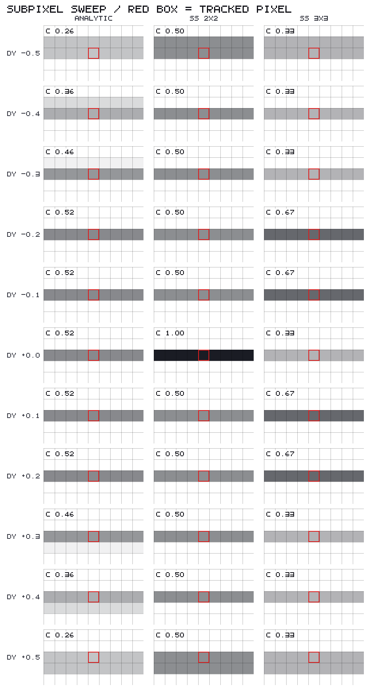

## 2. 细线与斜线：覆盖率图 + 误差热图

45° 细线的解析覆盖率图给出 `.76 / .13` 这类由真实交面积得到的数值：

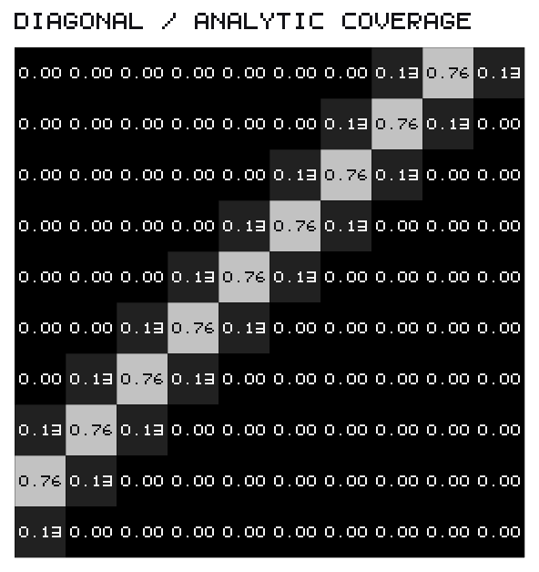

固定网格在同样位置只能给出 `1/4` 整数倍的覆盖率，规则网格与 45° 边缘对齐时还会产生
系统性偏差。误差热图统一用 Viridis 色标，SS2/SS3 共用同一把尺：

| SS 2×2 覆盖率 | SS 2×2 误差热图 | SS 3×3 误差热图 |
|---|---|---|
| 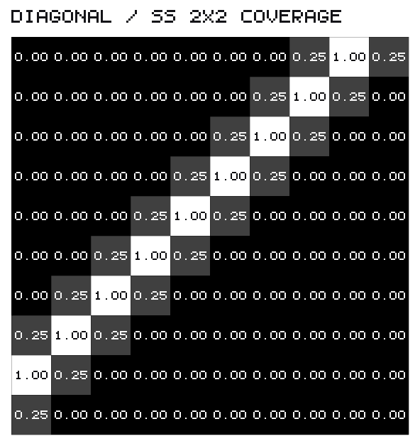 | 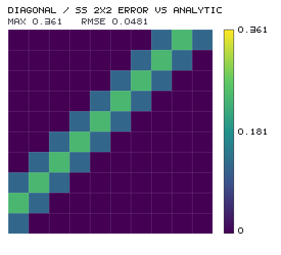 | 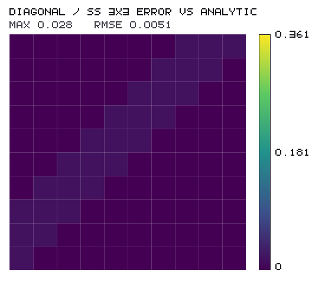 |

实测（`summary.json`，误差均相对于解析 alpha）：

| 场景 | ss2 max / RMSE | ss3 max / RMSE | blur max / RMSE |
|---|---|---|---|
| thin_h | 0.115 / 0.0121 | 0.147 / 0.0436 | 0.286 / 0.1146 |
| diagonal | 0.361 / 0.0481 | 0.028 / 0.0051 | 0.520 / 0.0867 |
| cross | 0.156 / 0.0329 | 0.077 / 0.0212 | 0.626 / 0.1176 |
| near_diag | 0.245 / 0.0593 | 0.082 / 0.0177 | 0.522 / 0.1131 |
| segregate | 0.200 / 0.0751 | 0.167 / 0.0662 | 0.666 / 0.2180 |

注意固定 N 并不保证“加样本就单调变好”：diagonal 的整图覆盖率总量在 `N=2/3/4/8/16/32`
时分别为 `31.0 / 20.6 / 25.8 / 23.1 / 21.8 / 21.2`，而解析值（=多边形面积，且通过
蒙特卡洛 `20.87` 交叉验证）是 `20.88`。规则网格与细条带的对齐会产生相干混叠，这正是
“2 倍 / 3 倍结果不能靠模糊糊过去”的量化证据。

## 3. 相交路径

两条不同颜色的斜线相交时，每个图层保留各自的解析覆盖率，再按 source-over 合成；
交叉点的混色来自正确的图层叠加，而不是模糊：

| 解析边缘特写 | SS 2×2 边缘特写 | SS 2×2 误差热图 |
|---|---|---|
| 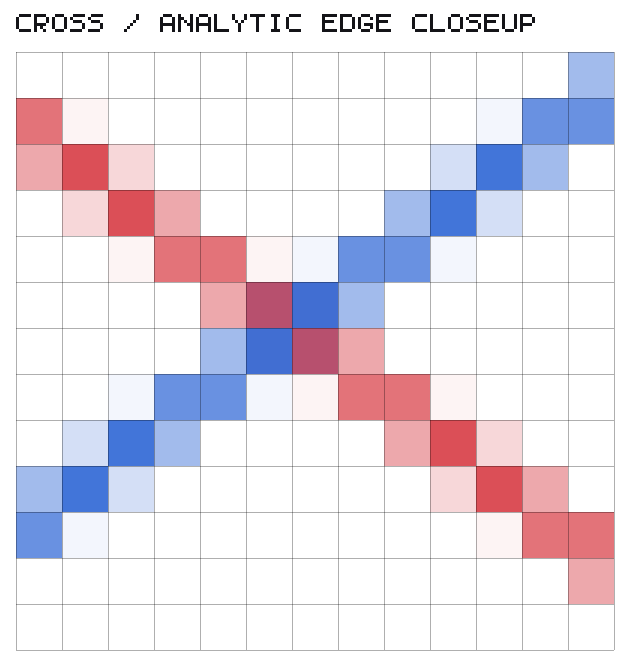 | 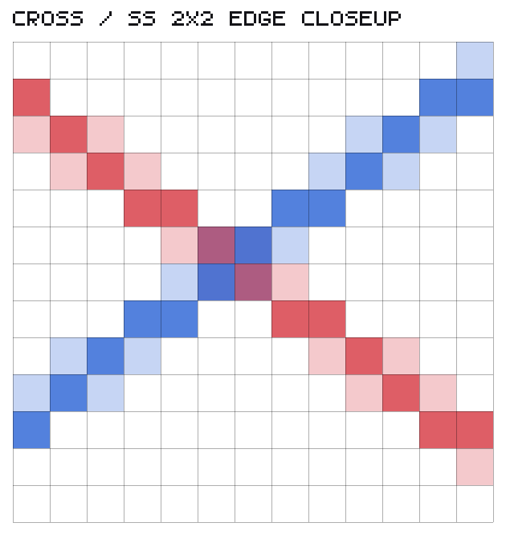 | 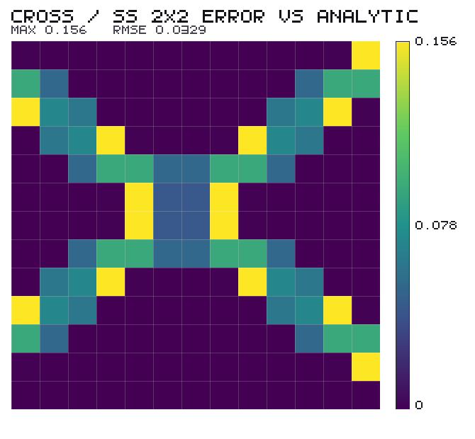 |

## 4. 不相交轮廓不得互相染色

`segregate` 的红、蓝、绿三条竖线之间有真实的几何空隙，保护像素 `(4,7)` 严格位于
红色多边形之外。所有真覆盖率方案在该像素上都是纯白 `(255,255,255)`；模糊基线把它染成了
`(190.1,164.1,195.6)` 的紫灰色：

| 解析特写：白色间隙 | 模糊特写：间隙被染紫 |
|---|---|
| 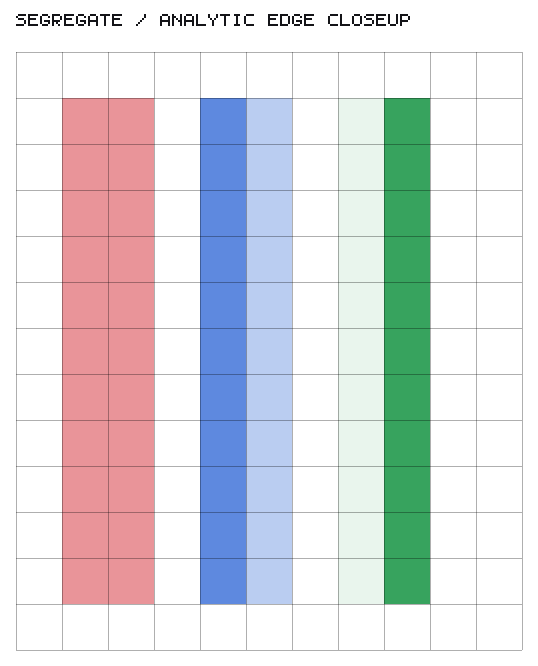 | 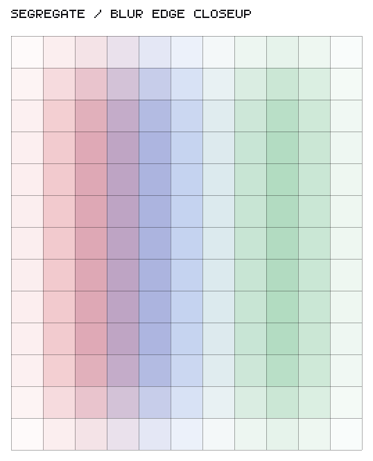 |

更严格的测量是“抽掉红色图层前后逐像素比较”，只统计解析红色覆盖率为 `0` 的像素
（`stain/segregate__red_<method>.png`，深色块是红轮廓自身 footprint，白线是其几何边界，
其余区域才是串色热区）：

| analytic 串色 | blur 串色 |
|---|---|
| 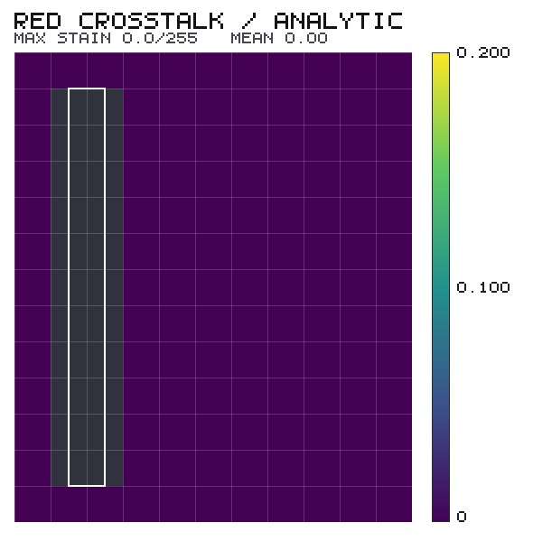 | 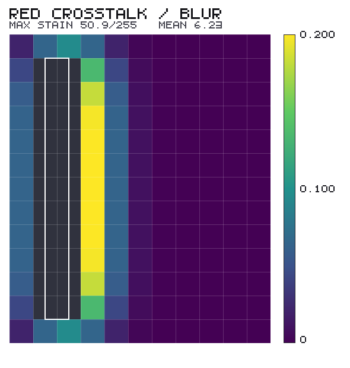 |

最大串色（0–255 通道差，`summary.json -> stains`）：

- analytic / ss2 / ss3：**0.00**（覆盖率为 0 时该图层的 source-over 是恒等变换）
- blur：**50.92**，均值 6.23

对 `near_diag` 两条相距约 1.7px 的平行斜线也有同样的逐图层零串色测试；模糊则会在间隙
里扫出一条紫色桥：

| 平行斜线解析特写 | 平行斜线模糊特写 |
|---|---|
| 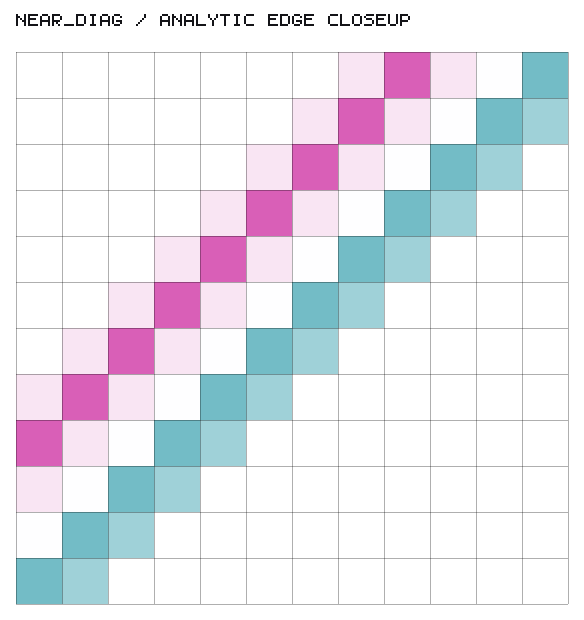 | 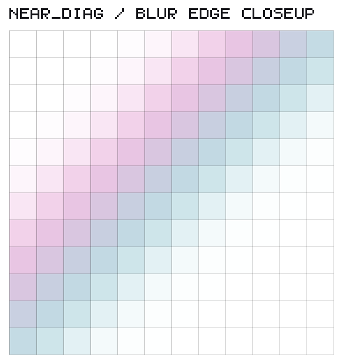 |

## 测试与内置检查

`go test -count=1 ./...` 覆盖：

- 像素裁剪面积与手算值一致；随机旋转矩形的“逐像素覆盖率之和 = 多边形面积”守恒；
- 细线 `0.05px` 平移的解析连续性 Lipschitz 上界；
- SS2/SS3 覆盖率必为 `1/N²` 的整数倍，并复现 `0.5 / 1/3` 的量化跳变；
- `segregate` 与 `near_diag` 上 analytic/ss2/ss3 的零串色、保护像素纯白；
- 模糊基线必然漏色（证明串色指标不是恒零）；
- SS8 相对 SS2 的 RMSE 收敛；
- `app.Run` 端到端生成全部 PNG/CSV/`summary.json`，且 `checks` 全部为 `true`。

`summary.json -> checks` 的键：`analytic_continuous_0p1`、
`ss2_shows_quantization`、`ss3_shows_quantization`、`analytic_guard_pixel_white`、
`ss2_guard_pixel_white`、`ss3_guard_pixel_white`、`analytic_zero_stain`、
`ss2_zero_stain`、`ss3_zero_stain`、`blur_baseline_leaks`。

## 代码结构

```text
geom/      Vec、多边形、Sutherland-Hodgman 裁剪、鞋带面积、射线法包含测试
cover/     AnalyticLayer / SampledLayer(N×N)、alpha 合成、高斯模糊基线、误差与串色度量
viz/       纯 image/png 输出：位图字体、覆盖率图、网格特写、Viridis 热图、折线图、胶片
scenes/    五个场景与亚像素扫描参数
app/       编排生成 out/ 与 summary.json
main.go / cmd/coverlab   两个等价入口
```
