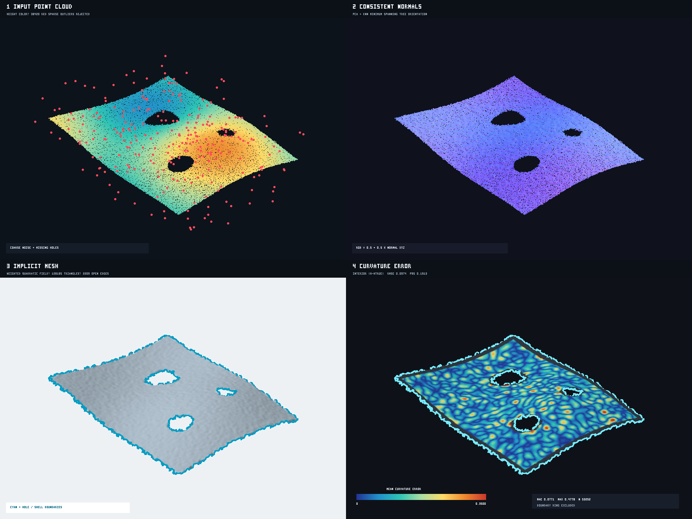
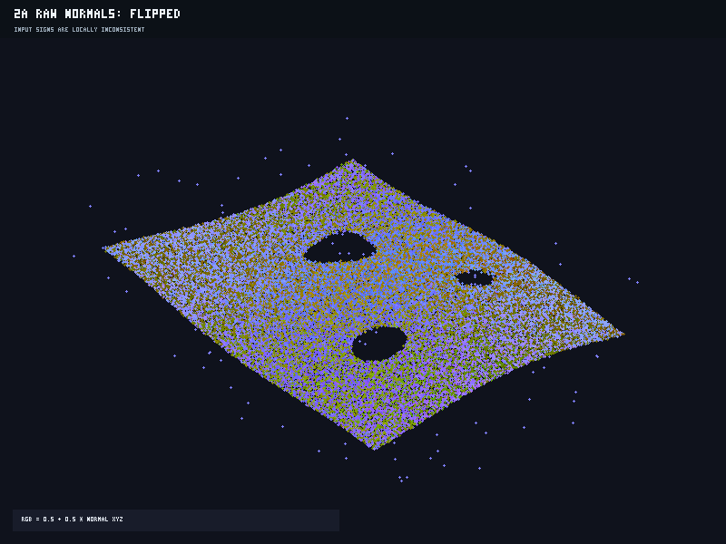
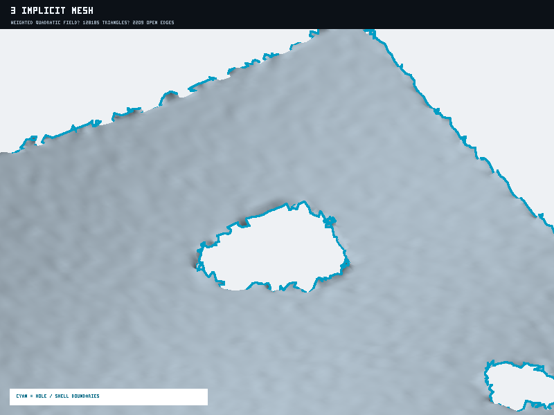

# 带噪点云的法线一致化与隐式表面重建（纯 Go）

零第三方依赖、仅使用 Go 标准库实现的点云重建实验台。默认生成一块带波浪曲率、
三个孔洞、测量噪声、稀疏离群点和随机翻转法线的薄壳，并完成：

1. kNN 平均距离 + 中位数/MAD 的统计离群点过滤；
2. 局部 PCA 法线估计；
3. kNN 图 + 最小生成树传播的法线方向一致化；
4. 紧支撑加权二次拟合构造隐式有符号场；
5. 六四面体 Marching Tetrahedra 零等值面提取；
6. 支撑域裁剪、小碎片清理和开放边界保留；
7. 输入点、法线色、重建网格、曲率误差四联渲染；
8. PLY/OBJ/JSON 导出与几何质量检查。

默认运行约 4–5 秒（Go 1.21+，普通笔记本 CPU），不需要 GPU、CGO 或任何 `go get`。

```bash
go run . -out out -strict
go test -count=1 ./...
```

也可以读取自己的点云：

```bash
go run . -input scan.ply -out out_scan
go run . -input points.xyz -out out_scan -cell 0.02
```

`.ply` 支持 ASCII、binary little-endian 和 binary big-endian；`.xyz/.txt/.asc`
支持 `x y z` 或 `x y z nx ny nz`。外部数据没有真值时，第四图显示曲率幅度而不是真值误差。

## 四联渲染



| 面板 | 文件 | 内容 |
| --- | --- | --- |
| 输入点 | `out/01_input_points.png` | 高程着色的噪点云，红色为被判定并拒绝的离群点 |
| 法线色 | `out/02_normal_color.png` | MST 一致化后的 `RGB = 0.5 + 0.5*n` |
| 重建网格 | `out/03_reconstructed_mesh.png` | 隐式零等值面，青色为开放边界 |
| 曲率误差 | `out/04_curvature_error.png` | 内部区域平均曲率误差，边界环不评分 |

额外诊断：

- `out/diagnostics/raw_inconsistent_normals.png`：输入法线随机翻转时的杂色；
- `out/diagnostics/hole_boundary_closeup.png`：孔洞开放边界特写；
- `out/cloud/raw_input.ply`：原始合成点云及翻转法线；
- `out/cloud/filtered_oriented.ply`：过滤并定向后的点和法线；
- `out/mesh/reconstructed.ply` / `.obj`：重建网格，PLY 带法线和曲率误差色；
- `out/report.json`：全部计数、误差、孔洞和 strict 检查结果。





## 默认样例的量化结果

下列数值来自一次确定性运行（种子 `20261127`），`report.json` 保存完整结果：

| 项目 | 数值 | 说明 |
| --- | ---: | --- |
| 原始点数 | `38420` | 含 `280` 个注入离群点 |
| 保留点数 | `38160` | 主体点误删为 `0` |
| 离群点召回率 | `92.9%` | 稳健 kNN 距离过滤 |
| 法线传播翻转 | `20674` | 单一 MST 连通分量 |
| 网格顶点 / 三角形 | `65186 / 128185` | 自适应体素约 `0.025` |
| 开放边界边 | `2209` | 外边界与三个孔边 |
| 几何法向距离 RMSE | `0.00222` | 噪声标准差为 `0.0065` |
| 系统性符号偏差 | `+0.00005` | 接近零，无整体膨胀 |
| 曲率误差 RMSE | `0.0974` | 分析尺度局部二次曲率 |
| 曲率误差 P95 | `0.1913` | 真值曲率为每单位长度量纲 |
| 孔洞核心三角形 | `0` | 三个孔均未被跨接成油膜 |

`-strict` 会检查离群点召回、主体保留、单一主分量、几何 RMSE、符号偏差、
曲率 RMSE 和孔洞核心；任一项失败时进程返回非零状态。

## 法线一致化

每个点取 `26` 个最近邻，对邻域协方差矩阵做对称 Jacobi 特征分解，最小特征值
对应 PCA 法线。PCA 只能给出无方向法线 `±n`，因此再用 `10` 近邻构造无向图：

```text
edge_weight(i,j) = 1 - |dot(n_i, n_j)|
```

Kruskal 生成最小支撑森林后，从每个分量的根开始 BFS；若相邻法线点积为负，
就翻转后续法线。最后让每个连通分量的平均方向朝向 `+Z`。全局反向不影响曲面，
但这一步让法线色和明暗渲染有稳定参考。

## 离群点过滤

KD 树查询每个点的 `12` 近邻，以平均邻距作为分数。阈值使用中位数和 MAD：

```text
robust_sigma = 1.4826 * median(|score - median(score)|)
threshold    = median(score) + 3.0 * robust_sigma
threshold    = max(threshold, 1.9 * median(score))
```

MAD 不会被少量极远离群点拉偏，`1.9 × median` 下限避免规则采样时 MAD 过小而
误删孔洞边缘的单侧邻域点。

## 隐式表面与“不膨胀、不补孔”

网格角点查询紧支撑半径内的点，使用 Wendland 权重拟合局部二次高度函数：

```text
z = c0 + c1 x + c2 y + c3 x² + c4 xy + c5 y²
F(q) = n · (q - centroid) - quadric_height(xq, yq)
```

`F=0` 即隐式表面。二次项比纯切平面更能跟随曲率，因此不需要放大体素或使用
强平滑来“糊”出连续表面。

防止油膜状膨胀的关键约束是：

- 拟合半径约 `2.9 × cell`，不使用跨大孔洞的全局核；
- 邻域不足或矩阵退化的格点标记为无效，不生成等值面；
- 抽取后的三角形质心必须靠近真实点云，超过约 `1.25 × cell` 就裁剪；
- 不运行 Poisson 填孔、不取膨胀等值面、不做会移动零面的全局平滑；
- 小于 `64` 个三角形的漂浮分量被删除。

因此主体在采样充分的区域连续，而孔洞中心保持空白，孔边形成自然开放边界。
几何符号偏差仅 `+0.00005`，说明零面没有系统性向法线外侧膨胀。

## 渲染与曲率误差

所有图像均由标准库 `image`/`image/png` 和内置 3×5 点阵字体生成：

- 正交相机和包围盒自适应缩放；
- z-buffer 点精灵、线段和三角形光栅化；
- 重心坐标插值深度、法线和顶点色；
- 方向光与双面漫反射，避免开放薄壳背面发黑；
- 青色边界线直接来自“只被一个三角形引用”的边。

合成曲面的高度函数和平均曲率真值由 `demoHeight`、`demoCurvature` 给出。
重建曲率不是直接放大量化网格的二阶差分，而是在网格顶点处重新进行较大支撑
尺度的加权二次拟合，再由二次曲面系数计算平均曲率。孔洞边界三环和参数域边缘
不纳入曲率评分，避免单侧拟合污染指标。

## 代码结构

| 文件 | 职责 |
| --- | --- |
| `main.go` | 命令行参数、进度输出和 strict 退出码 |
| `demo.go` | 确定性带孔波浪薄壳、噪声、离群点和随机法线翻转 |
| `kdtree.go` | 零依赖 KD 树和 kNN/半径搜索 |
| `processing.go` | MAD 离群过滤、PCA 法线、MST 方向一致化 |
| `implicit.go` | 自适应体素和加权二次隐式场 |
| `extract.go` | Marching Tetrahedra、边顶点焊接、支撑域裁剪 |
| `field_curvature.go` | 二次曲面解析法线和平均曲率 |
| `curvature.go` | 网格曲率、边界环屏蔽、误差统计 |
| `metrics.go` / `checks.go` | 几何偏差、孔洞侵入和质量门槛 |
| `render.go` / `render3d.go` / `panels.go` | 软件相机、z-buffer、点/线/三角形和四联图 |
| `ply_parse.go` / `cloud.go` / `mesh.go` | PLY/XYZ 读取与 PLY/OBJ 导出 |
| `surfacelab_test.go` | 定向、过滤、曲率恢复和端到端质量测试 |

## 参数

- `-out out`：产物目录；
- `-input ""`：外部 `.ply/.xyz/.txt/.asc`，留空运行内置样例；
- `-cell 0`：隐式格边长，`0` 表示按点距自适应；点云很密或需要更快预览时可显式调大；
- `-seed 20261127`：合成样例随机种子；
- `-yaw -0.68 -pitch 0.58`：渲染视角；
- `-strict`：质量检查失败时返回非零退出码。

对于外部扫描，建议点云单位一致且大致为 Z-up；MST 会保证局部法线一致，
`+Z` 只决定整个连通分量的全局正反。若数据是完全封闭物体，可在查看 PLY 后
按需要整体反转法线或在后续加入视点符号约束。当前实现刻意不做大规模填洞，
因此大缺失区会保持开放，这正是本题要求的边界行为。
