# 多视角深度 TSDF 融合实验台（Go 标准库）

纯 Go、零第三方依赖实现的多视角深度融合程序。它会程序化生成三组带空洞、
深度噪声和轻微外参错位的深度图，然后完成：

1. 相机投影/反投影与合成深度渲染；
2. 带置信度和累计权重上限的 TSDF 加权融合；
3. `|TSDF|`/权重阈值细胞提取；
4. 二维步进三角零轮廓与三维 Marching Tetrahedra 等值面提取；
5. PNG 拼图、体素截面、软件 z-buffer 表面渲染、误差热图和 PLY 导出；
6. 薄片厚度、凹角定位、空区分填、覆盖率、原始点云对照和粗体素对照检查。

默认体素为 `15 mm`，不是靠把体素调大来“磨平”轮廓。另跑一组 `50 mm`
粗体素作为反面控制：薄片截面 RMSE 从 `5.1 mm` 恶化到 `48.9 mm`，厚度
明显膨胀或丢失。

## 运行

```bash
go run . -out out
go test -count=1 ./...
go run . -out out -voxel 0.015 -strict
```

常用参数：

- `-out out`：PNG/PLY/JSON 输出目录；
- `-width 256 -height 192`：合成深度图分辨率；
- `-voxel 0.015`：细 TSDF 体素尺寸（米）；
- `-strict`：任一几何检查失败时以非零状态退出。

`go.mod` 没有 require，图像仅用 `image/png`，三维文件是手写 ASCII PLY。

## 三组场景

| ID | 场景 | 视角 | 检查重点 |
| --- | --- | ---: | --- |
| `thin_sheet` | `1.24 × 0.045 × 1.15 m` 薄片 | 8 | 正反两面不合并、厚度不膨胀、边缘不出现双零面 |
| `concave_corner` | 两面 `90°` 内凹墙 | 8 | 凹角位置、角平分线空区不被 TSDF 填成圆角 |
| `wide_baseline` | 三个前后遮挡方块 | 6 | `60°` 间隔、相邻光心基线约 `2.9 m`，检查遮挡/空洞补全和覆盖率 |

每个视角都有独立的确定性随机空洞、散点缺失和深度噪声。融合使用的外参
比真实拍摄外参多一组成对、零均值的小平移/旋转误差；直接用这些外参反投影
会在截面中留下不同颜色的叠层。

## 产物导航

```text
out/
  report.json
  depth/<scene>__raw_depth_mosaic.png
  cloud/<scene>__raw_cloud_layers.png
  section/<scene>__voxel_section.png
  section/<scene>__coarse_control_section.png
  heatmap/<scene>__error_heatmap.png
  surface/<scene>__surface.png
  surface/<scene>__surface_error.png
  mesh/<scene>__surface.ply
  points/<scene>__threshold_cells.ply
  points/<scene>__raw_cloud.ply
```

- `raw_depth_mosaic.png`：所有原始深度视角，品红为被挖掉的空洞；
- `raw_cloud_layers.png`：用带误差外参直接反投影的 XY 切片，彩色点即叠层；
- `voxel_section.png`：TSDF、累计权重、阈值带/零轮廓三联截面；
- `coarse_control_section.png`：`50 mm` 粗体素反面控制；
- `error_heatmap.png`：`|融合度量 SDF - 解析 SDF|` 热图和零轮廓；
- `surface.png` / `surface_error.png`：提取网格的着色图与顶点误差图；
- `surface.ply`：带法线和误差色的 Marching Tetrahedra 网格。

## TSDF 与权重更新

体素保存归一化截断距离 `D ∈ [-1,1]` 和累计置信权重 `W`。截断带为
`2.5 × 15 mm = 37.5 mm`，小于薄片 `45 mm` 厚度，避免正反视角在薄片
背后发生符号冲突。

对每个投影像素，先用深度邻域恢复法线，再计算点到平面的有符号距离；
法线不可靠时回退到投影光轴深度差：

```text
d_plane = n_pixel · (V - unproject(px, py, depth))
d_proj  = depth_pixel - z_camera(V)
s       = clamp(d_metric / truncation, -1, +1)
```

权重由深度衰减、入射角和深度边缘不连续性组成。累计更新是标准加权均值，
并显式饱和到 `W_max = 12`：

```text
W' = min(W_max, W + w)
D' = (W * D + w * s) / (W + w)
```

对应纯函数为 `UpdateWeight`，有单元测试覆盖首次赋值、加权平均、
权重上限和零权重。

## 阈值与表面提取

- 阈值细胞：`W >= 0.18 && |D| <= 0.35`，导出
  `points/<scene>__threshold_cells.ply`；
- 二维截面：每个 XY 方格拆成两个步进三角形，在异号边上插值零交点；
- 三维表面：每个体素立方体拆成 6 个四面体，在异号角点间生成三角形；
  网格边用端点体素编号去重，三角形朝向由 TSDF 梯度校正；
- 误差基准：所有场景几何都是解析 AABB，`Geometry.SDF` 给出精确
  欧氏有符号距离。网格顶点误差为 `|SDF(point)|`，截面轮廓同理。

## 量化结果

下列数值来自一次确定性运行；`go test` 会在临时目录重跑并强制所有检查通过。

| 场景 | 原始点云 RMSE | TSDF 轮廓 RMSE | 网格 RMSE | P95 | 覆盖率 | 50 mm 粗体素 RMSE |
| --- | ---: | ---: | ---: | ---: | ---: | ---: |
| 薄片 | 6.22 mm | 5.14 mm | 5.00 mm | 9.24 mm | 100.0% | 48.94 mm |
| 凹角 | 6.61 mm | 3.77 mm | 4.45 mm | 7.55 mm | 100.0% | 11.11 mm |
| 大基线 | 6.23 mm | 4.85 mm | 5.28 mm | 10.52 mm | 99.8%–100% | 14.53 mm |

附加几何检查：

- 薄片平均厚度约 `49.7 mm`，真值 `45 mm`，误差 `4.7 mm`；
- 凹角定位误差约 `0.8 mm`；
- 凹角内侧角平分线探测点保持正 SDF（约 `17 mm`），说明空区没有被填实；
- 三组场景中细体素轮廓都优于直接点云和 `50 mm` 粗体素控制；
- `report.json` 保存每个检查的 `pass/value/threshold`。

## 图像索引

### 薄片

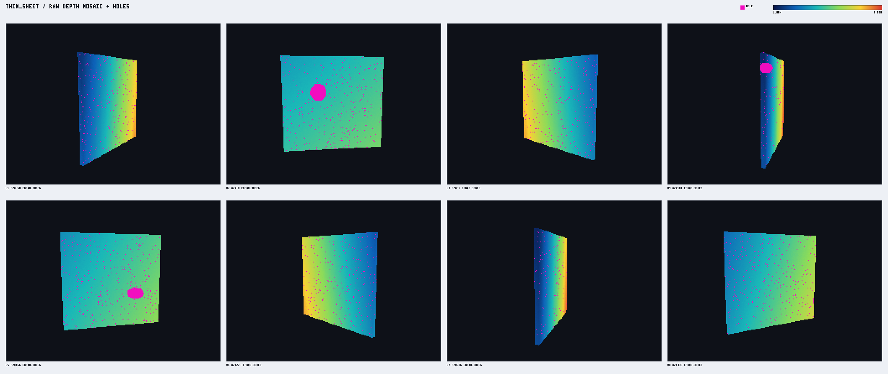

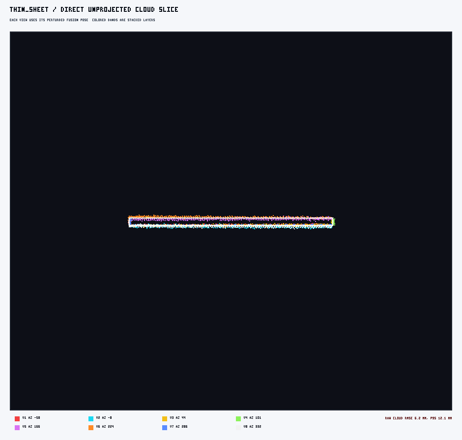

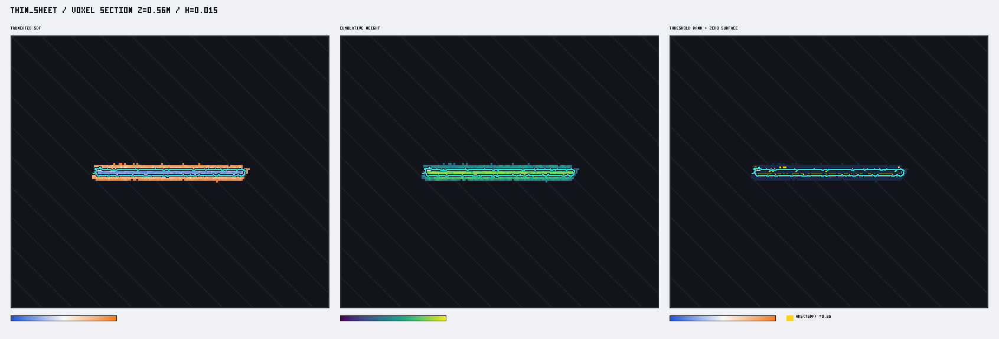

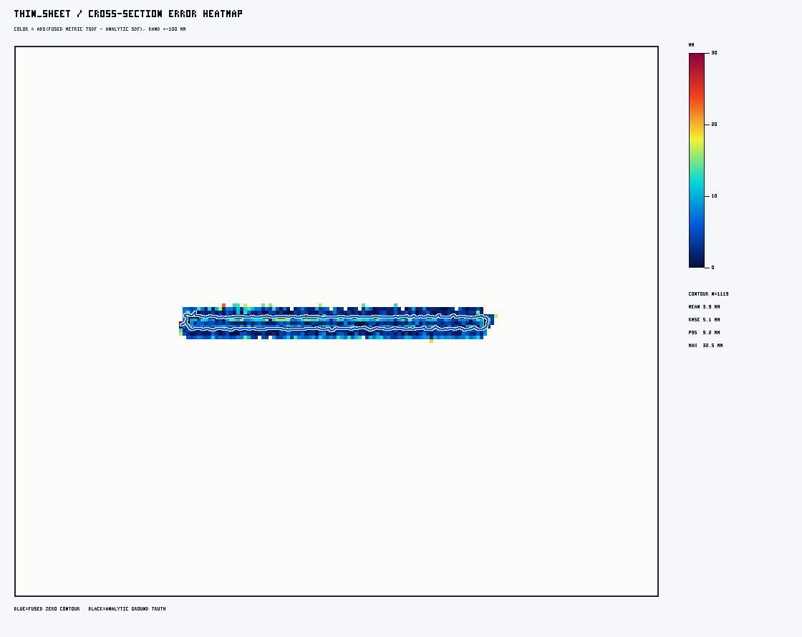

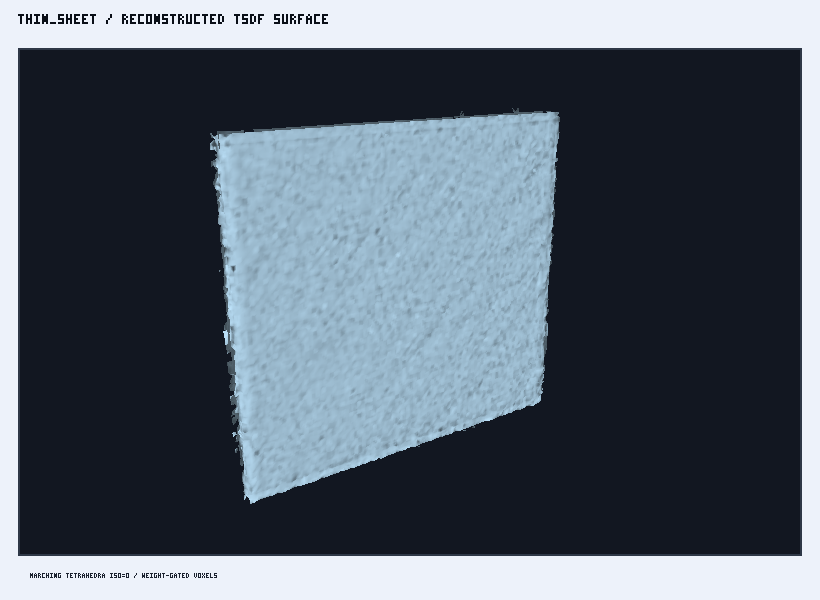

### 凹角

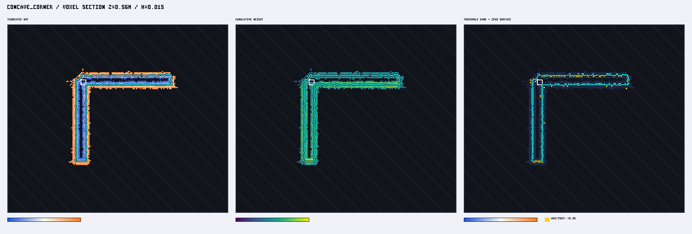

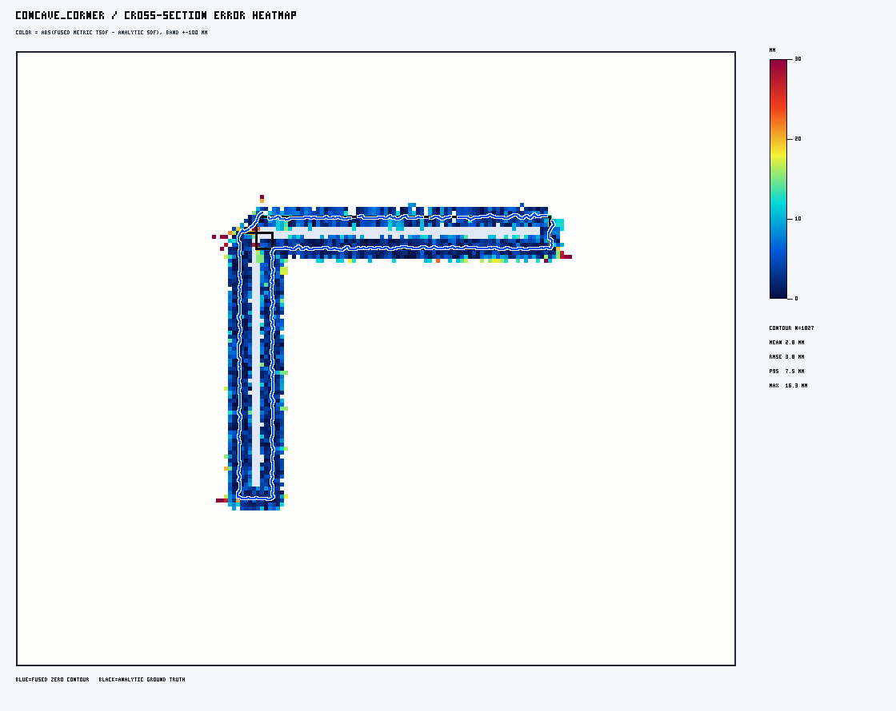

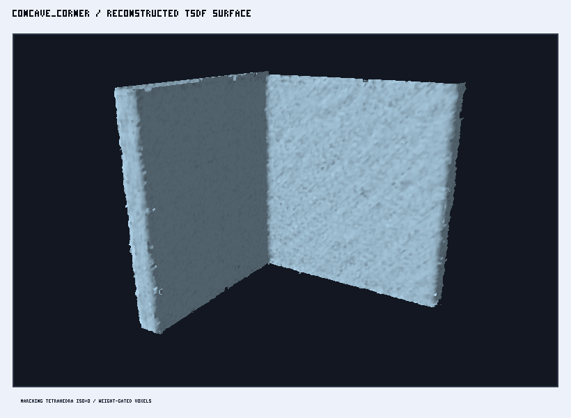

### 大基线

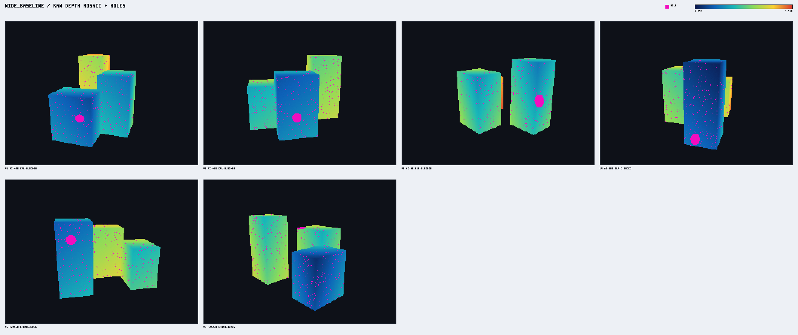

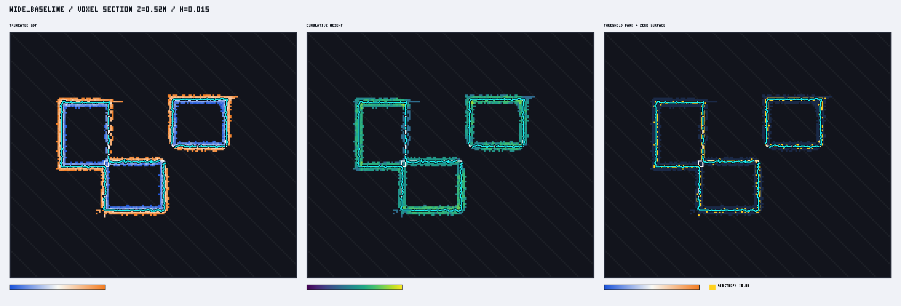

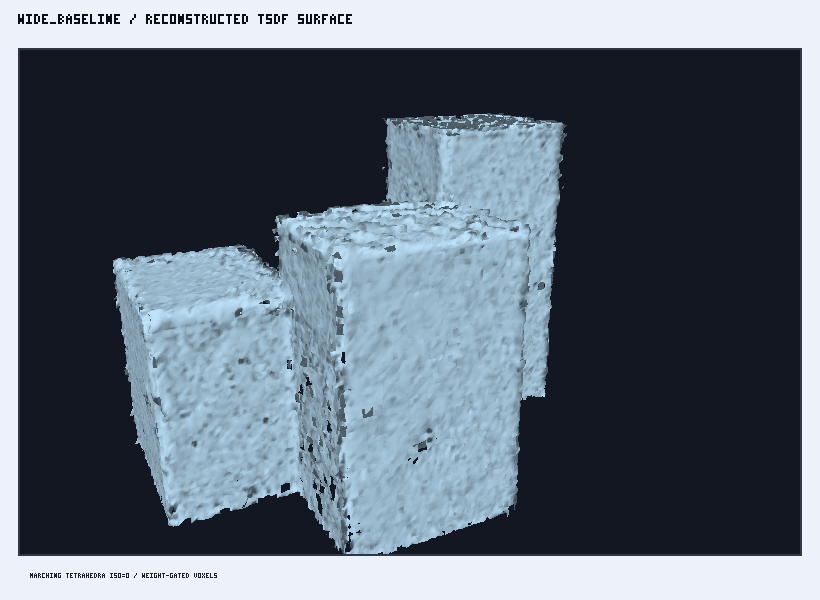

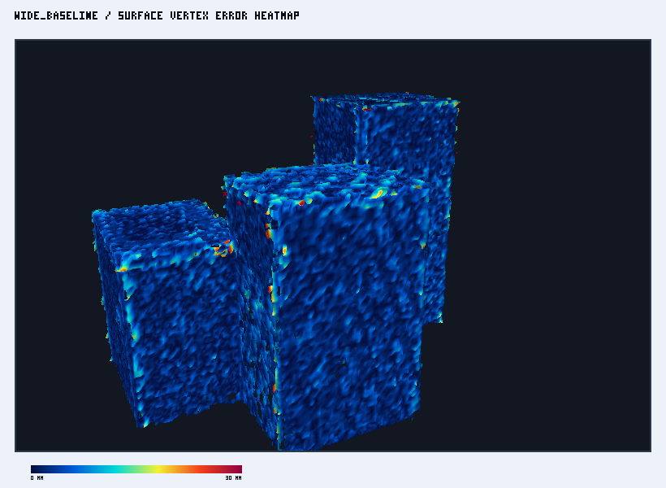

完整逐视角深度、原始叠层、误差色表面和粗体素图均在 `out/` 对应子目录。
