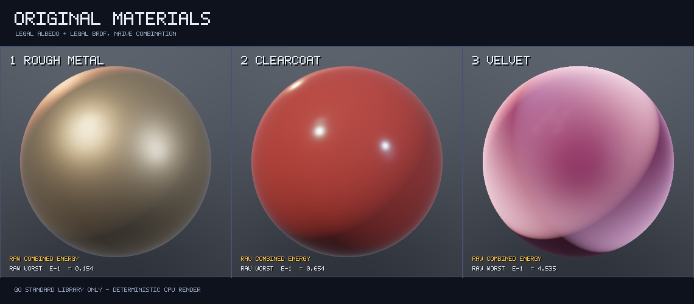
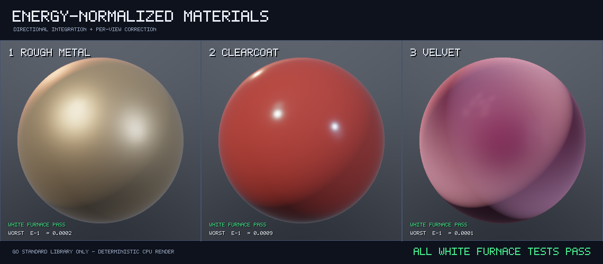
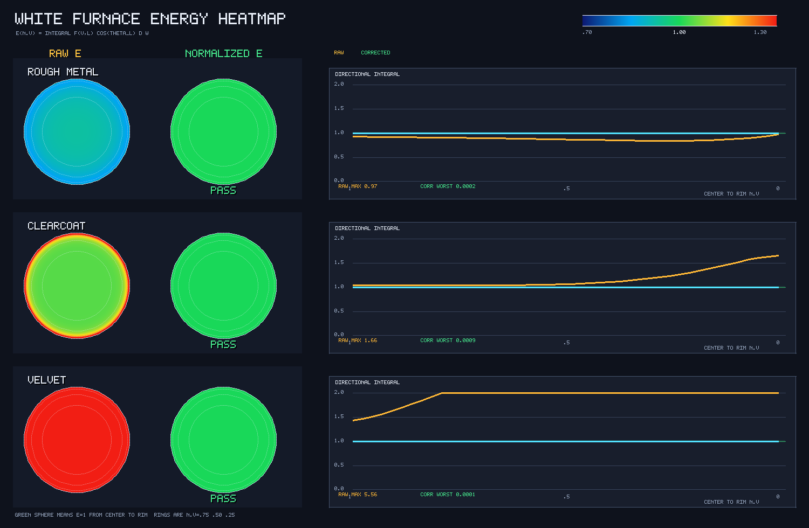
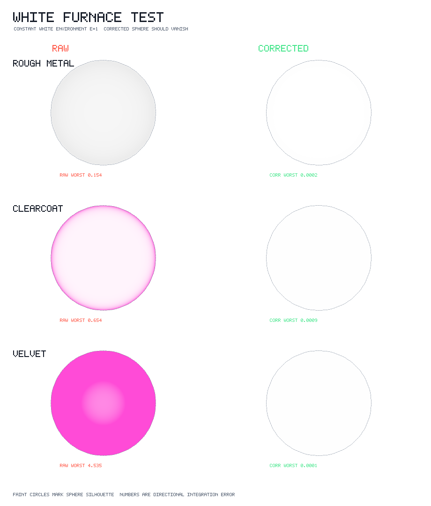

# White Furnace BRDF Energy Lab

纯 Go 标准库实现的 BRDF 能量诊断与修正工具。反照率、Fresnel、GGX、清漆和天鹅绒旁瓣各自都在合法数值范围内，但直接相加仍可能让某个视角的半球积分大于或小于 1。本项目实现：

- 白炉测试（white furnace test）
- 按出射方向 `mu = N·V` 的半球积分 `E(mu)`
- 方向能量 LUT、逐视角缩放和缺失能量补偿
- 粗糙金属、清漆、天鹅绒三种材质
- 原始材质、修正材质、白炉对照球和能量热图渲染
- JSON 指标报告与 `go test` 回归

没有第三方 Go 依赖，`go list -m all` 只输出模块自身。

## 运行

```sh
go run .
# 或
make render

go test ./... -count=1
go vet ./...
```

常用参数：

```sh
go run . -panel 420
```

默认输出到 `out/`，并复制一份 JSON 到 `artifacts/energy_report.json`。

## 图像产物

- `out/original_materials.png`：参数合法但未做组合能量预算的原始材质。
- `out/corrected_materials.png`：方向积分归一后的三种材质。
- `out/energy_heatmap.png`：原始/修正球面能量热图与 `E(mu)` 曲线。
- `out/white_furnace.png`：纯白环境下的原始球与修正球；修正球应融入白底，只保留定位轮廓。
- `out/energy_report.json`：每个方向、球面边缘环和 MIS 积分的误差。









## 方向积分

对局部着色系中法线 `N=(0,0,1)`、出射方向 `V`，方向反照率为：

```text
E(V) = ∫_Ω f(V,L) max(N·L,0) dωL
```

由于材质各向同性，只依赖 `mu=N·V`。代码提供三种积分路径：

- `IntegrateHemisphere`：确定性 Hammersley 余弦加权积分，适合 Lambert 和宽天鹅绒旁瓣。
- `integrateGGXEnergy`：GGX visible-normal重要性采样，估计 `F * G2/G1`，在掠射角仍稳定。
- `IntegrateBRDFMIS`：余弦采样与 GGX VNDF 的平衡启发式 MIS，直接积分最终的 `NormalizedBRDF`。

`BuildEnergyTable` 在 `mu=0.002..1` 上建立 96 个方向节点。球面上的中心、中环和轮廓像素都查询同一方向能量函数，因此修正不是只在球心成立。

## 能量归一

白炉材质会把所有允许为 1 的反照率/F0/绒光颜色设为 1，同时保留粗糙度和旁瓣形状。设白炉原始方向能量为 `E_raw(mu)`：

- `E_raw > 1`：使用 `scale = 1/E_raw` 压回单位能量，解决清漆掠射 Fresnel 与漫反射重复相加、天鹅绒艺术家权重过强等问题。
- `E_raw < 1`：保留原始单散射 GGX，并加入 `deficit = 1-E_raw` 的多次散射/能量补偿项 `albedo * deficit / π`，避免粗糙金属边缘发暗。

彩色材质使用同一白炉形状系数，补偿色为当前反照率；因此普通渲染不会被错误地整体拉成白色，同时每个颜色通道仍满足单位入射能量上限。

## 实测结果

默认报告容差为 `0.025`。一次确定性运行的结果：

| 材质 | 原始最大 `|E-1|` | 修正最大 `|E-1|` | 球面最坏误差 | MIS 直接积分误差 |
| --- | ---: | ---: | ---: | ---: |
| 粗糙金属 | 0.1540 | 0.00020 | 0.00019 | 0.00136 |
| 清漆 | 0.6536 | 0.00085 | 0.00084 | 0.00093 |
| 天鹅绒 | 4.5349 | 0.00007 | 0.00026 | 0.00001 |

完整数值见 `out/energy_report.json`。`TestWhiteFurnacePresets` 会遍历球心到 `N·V=0.02` 的方向；`MeasureSphereFurnace` 扫描 256×256 投影球的数千个法线位置和径向轮廓采样；`TestMISWhiteFurnaceOfActualBRDF` 不使用分量分解，而是直接积分最终 BRDF。

## 代码结构

- `furnace/vec.go`：三维向量、RGB 和数值工具。
- `furnace/material.go`：三种材质预设与白炉变体。
- `furnace/brdf.go`：Lambert、Schlick Fresnel、GGX/Smith、清漆和天鹅绒 BRDF。
- `furnace/integrate.go`：Hammersley、余弦半球、VNDF 和方向积分。
- `furnace/mis.go`：余弦/GGX 多重重要性采样。
- `furnace/normalize.go`：方向能量 LUT、缩放/补偿和 `NormalizedBRDF`。
- `furnace/whitefurnace.go`：白炉报告与全球面法线扫描。
- `furnace/render.go`、`furnace/panels.go`：确定性 CPU 球渲染和三联图。
- `furnace/heatmap.go`、`furnace/whitefurnace_image.go`：能量热图、曲线和白炉对照图。
- `main.go`：生成全部 PNG/JSON 产物的零依赖 CLI。

## 设计说明

数学意义上的严格零误差需要解析方向反照率或无限样本。这里使用高分辨率确定性低差异积分和 LUT，使三种预设在 `N·V >= 0.02` 的可见球面上误差远低于常见图形测试容差；`mu < 0.02` 是极窄轮廓/像素覆盖问题，报告中保留到 `0.006` 的诊断采样。MIS 路径避免窄 GGX 高光在朴素余弦蒙特卡洛中产生 firefly 误判。
