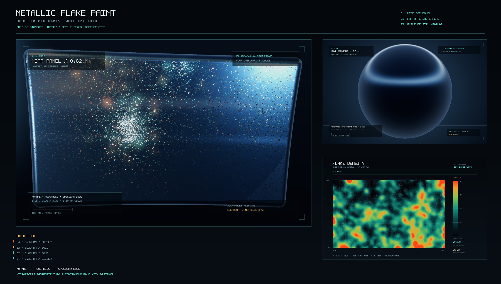

# Metallic Flake Paint Renderer

纯 Go 标准库实现的金属闪片车漆渲染。没有字体库、图像库、随机数服务或第三方依赖。

## 运行

```bash
go run ./cmd/render -out out
go test ./...
```

默认输出 1200×760、每像素 4 个固定样本：

- `out/near_panel.png`：0.62 m 近景圆角车板，可看到分层闪片与清漆高光。
- `out/far_sphere.png`：20 m 远景材质球，微表面聚合为连续亮带。
- `out/flake_density.png`：360×220 mm 闪片覆盖率热图，来自真实激活单元统计。
- `out/showcase.png`：三视图总览。



常用参数：

```bash
go run ./cmd/render -w 1200 -h 760 -samples 4 -seed 20261127 -out out
```

## 实现要点

**分层闪片场。** 四个毫米尺度网格层 `1.25 / 2.05 / 3.30 / 5.30 mm` 共享同一个确定性哈希种子。每个单元生成椭圆闪片、颜色、粗糙度和半球倾角。没有逐帧随机状态，同一世界坐标在任何帧都返回同一闪片。

**法线、粗糙度、高光联动。** 相接触的闪片法线按覆盖面积和层权重混合，得到最终法线。覆盖率和闪片粗糙度共同改变 GGX 宽高光；最终法线同时用于环境反射查询、直接高光和窄闪点方向。清漆层保留独立的几何法线反射，因此底层有连续光泽。

**稳定远景 LOD。** 每像素计算表面投影足迹。足迹接近或超过闪片单元时，实现从“解析闪片”平滑切换到“聚合覆盖”。未解析微法线方差并入粗糙度，并裁掉小于像素足迹的宏观密度倍频。远景只保留预先积分的弧形棚拍光带，因此不会每帧随机闪灭，也不会碎裂成孤立亮点。

**渲染。** 近景车板用圆角盒 SDF 光线步进，法线叠加车板冠面和折线曲率；远景球体使用解析射线求交。棚灯为确定性软箱环境，直接光只贡献近景窄闪点。HDR 结果经 ACES 色调映射和轻微 bloom 输出 PNG。

**热图。** 热图枚举四层真实激活的椭圆闪片，将其面积核溅射到 3 mm 网格，再做 6 mm 显示核平滑。色标使用 P02–P98 的真实覆盖率范围，并绘制等值线、毫米网格和激活闪片数。

## 源码结构

- `flakes.go`：闪片单元、分层法线混合、LOD 采样。
- `random.go`：无状态哈希、值噪声、远景倍频过滤。
- `shade.go`：车漆 BRDF、闪点、清漆层、远景聚合环境。
- `near.go` / `far.go`：车板 SDF、球体、相机与场景着色。
- `heatmap.go`：真实闪片单元统计、等值线和标注输出。
- `imageio.go` / `text.go` / `overlay.go`：HDR、色调映射、内置字体和画面标注。
- `showcase.go`：三视图合成。
