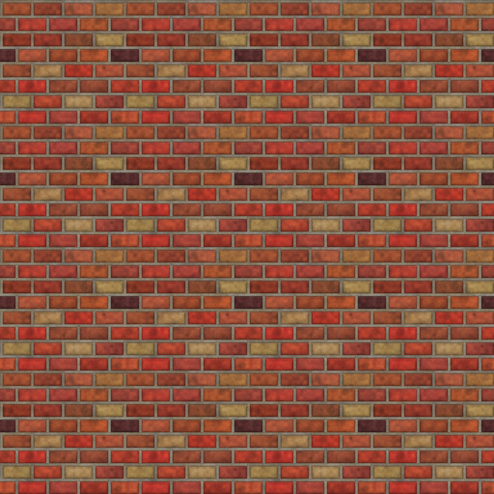
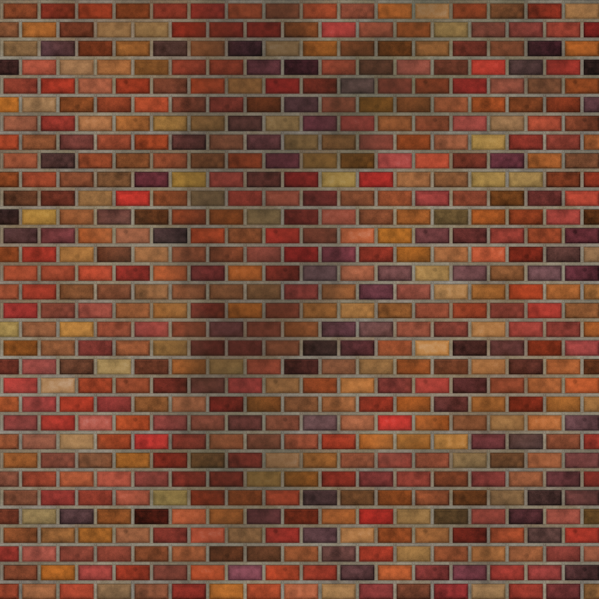
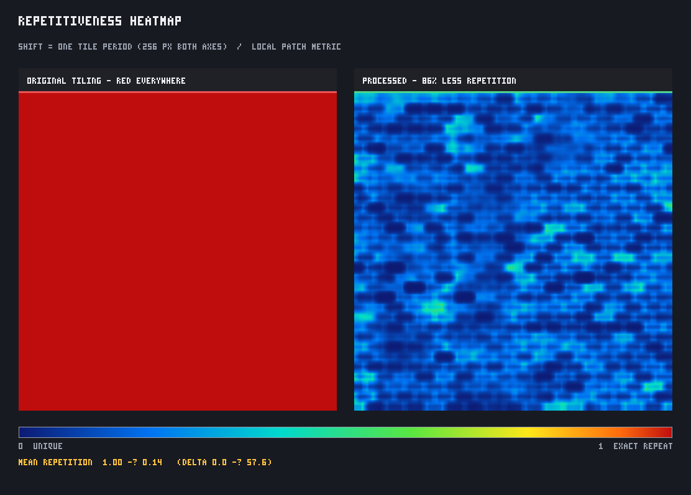
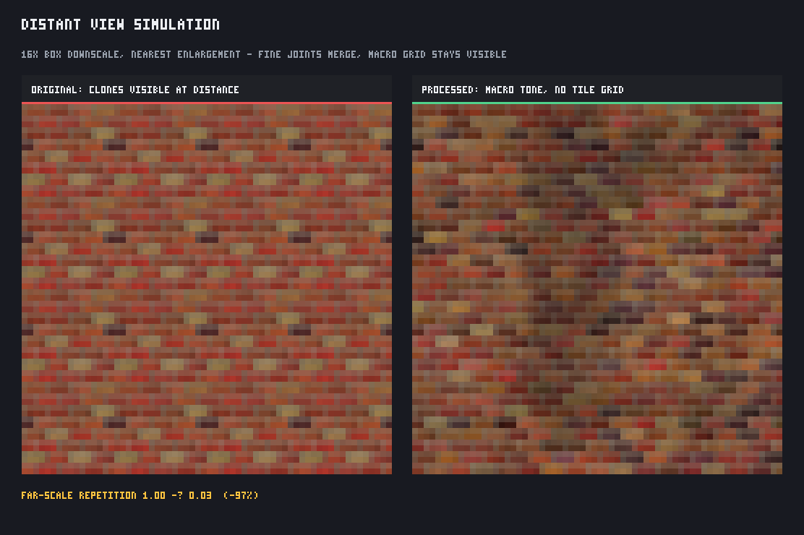
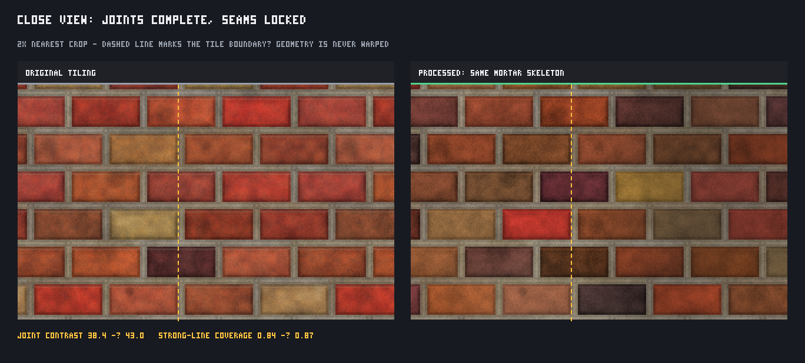
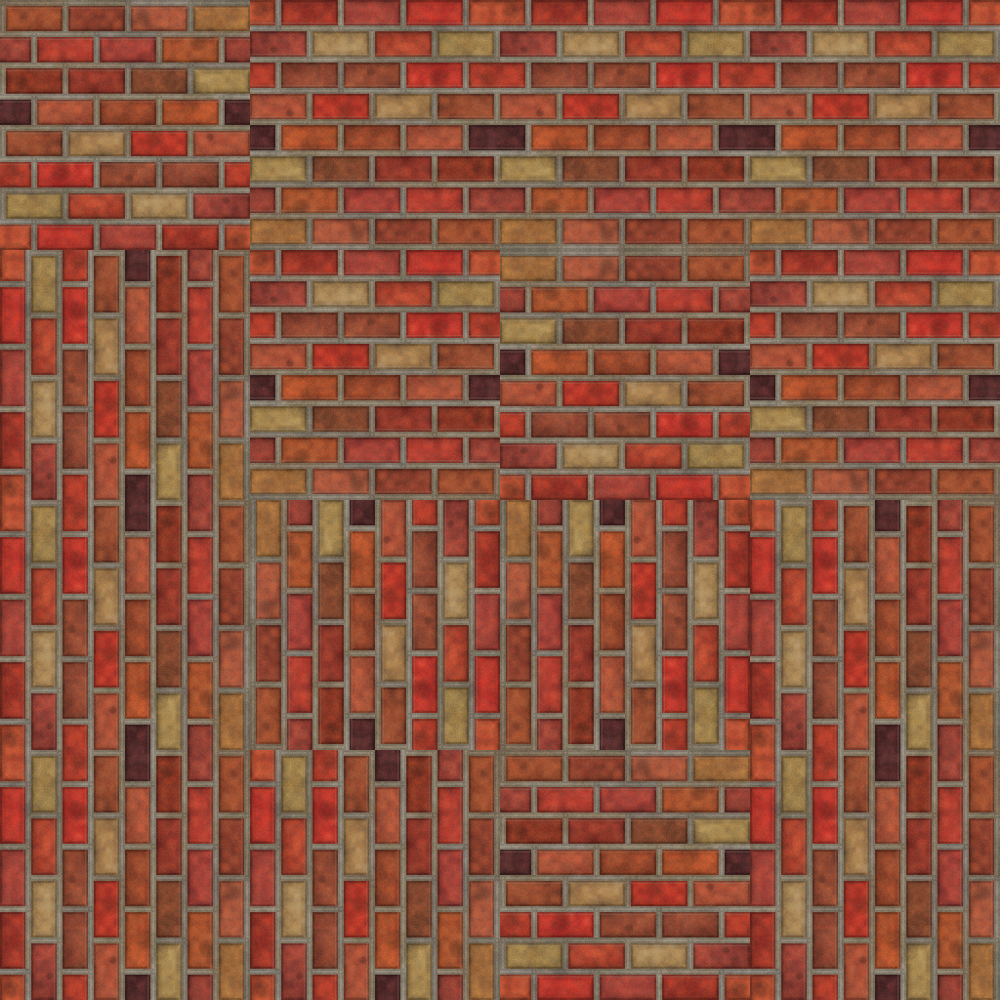

# brickfix — 砖墙平铺去周期化

规则砖墙贴图直接 `x%256 / y%256` 平铺会出现肉眼可辨的“克隆网格”。
本项目用纯 Go 标准库实现一套**不动砖缝几何**的去周期处理：
低频偏移场、按世界砖格稳定哈希的局部色变、跨 tile 边界连续的染料混合，
并输出原始平铺、处理结果与 tile 周期重复性热图。

`go.mod` 无任何 `require`，外部依赖为零。

## 一键运行

```bash
go run .                         # 生成到 outputs/
go run . -out outputs -seed 7    # 可复现实验
go test ./...                    # 几何对齐 / 周期噪声 / 热图不变量
```

## 三类核心结果

| 原始平铺（周期感明显） | 处理结果（克隆感消失，砖缝完整） |
|---|---|
|  |  |

重复性热图（红 = 与一个 tile 周期外的区域完全相同；蓝 = 低重复）：



远景模拟与近景砖缝检查：

| 远景：左仍有 4×4 克隆块，右只有宏观色调 | 近景：砂浆骨架逐像素保留，虚线为 tile 边界 |
|---|---|
|  |  |

“每格随机旋转整张贴图”的反例（砖块被转成竖向、跨格砖缝错乱）：



## 实现思路

砖格参数：tile `256×256`，砖距 `64×32`，灰缝宽 `6`；tile 宽为 4 个砖距、
高为 8 皮（偶数皮保证错缝排行的奇偶性周期），因此 tile 本身无缝。

1. **结构锁定（先保证不破坏砖缝/墙角）**
   `BrickAt`（`brick.go:39`）是烘焙与后处理共用的唯一几何来源。
   处理时底图永远采样 `tile[x%256, y%256]`，**不做任何整图旋转、平移或 UV 扰动**，
   所以灰缝位置、tile 边界与墙角接缝不会移动，更不会把墙角接缝挪进纹理内部。

2. **低频偏移**
   两张去相关的平滑 FBM 噪声组成低频向量场（`effect.go:82` 附近），
   振幅约 ±22 px，只用于偏移“染料层 / 中期斑驳”的采样坐标；
   另有大尺度 FBM 驱动整体明度/色相缓漂。偏移不接触砖 UV 与遮罩，
   因此只会让污渍边缘更自然，不会扭动砖缝。

3. **局部色变**
   用世界坐标的 `(row, col)` 哈希出稳定种子，为每一块砖重新选择
   红/橙/棕、青灰砖、土黄、熟料深砖等真实土色系色相/饱和度，
   同时完整保留烘焙明度场（黏土斑驳、倒角、AO、颗粒），见 `effect.go:101`。
   同一个源 tile 的每次重复因此变成不同的砖，但相邻像素不会闪烁。
   灰浆不做逐砖跳变，只接受连续宏观变化，保持砖缝统一完整。

4. **边界连续染料混合**
   烟灰、赭石径流、泛碱白、苔绿等颜料浓度全部定义在**整张墙的世界坐标**
   FBM 场上，并经低频偏移场扭曲（`effect.go:150` 的 `blendDyes`）。
   不存在“每个 tile 各自的染料状态”，所以颜色在 `x/y=256k` 边界两侧天然连续，
   是比“边界再做交叉淡化”更彻底的边界连续方案；重叠颜料按浓度加权混合。

## 重复性热图定义

对每个像素，比较它与位移一个 tile 周期后的颜色距离，
取 `(+256,0)`、`(0,+256)`、`(+256,+256)` 三个方向的均值，
再用积分图做局部窗口均值得到 patch 残差 `Δ`，最后评分

```
R = exp(-Δ / τ)        # R≈1 完全重复（红），R≈0 唯一（蓝）
```

分别在原分辨率（近景）、4× 降采样（中景）、16× 降采样（远景）计算，
对应 `pipeline.go` 中的尺度表。原始平铺在所有尺度上 `Δ=0、R=1`。

## 量化结果（默认 seed，详见 `outputs/metrics.json`）

| 尺度 | 原始重复分 | 处理重复分 | 重复度下降 |
|---|---:|---:|---:|
| 近景 1×  | 1.000 | 0.139 | 86% |
| 中景 4×  | 1.000 | 0.075 | 92% |
| 远景 16× | 1.000 | 0.026 | 97% |

结构与边界指标：

- 砖缝强对比覆盖率：原始 `0.84` → 处理 `0.87`（未下降，对比反而略强）；
  随机旋转基线掉到 `0.48`。
- tile 接缝 / 同几何对照线的跳变比：原始 `0.95`、处理 `0.92`，均≈1，
  说明处理没有引入额外边界跳变。
- `go test` 逐像素校验：`BrickAt(x+256,y)` / `BrickAt(x,y+256)` 与原格
  的 `Lx/Ly/Mortar` 完全一致；周期噪声在 tile 边界严格相等；
  原始平铺热图必须为满分；处理后重复分必须低于 0.5 且砖缝覆盖不显著退化。

## 产物清单

- `outputs/01_original_tiling.png`：原始精确平铺（1024²）
- `outputs/02_processed_result.png`：三层处理结果（1024²）
- `outputs/03_repetition_heatmap.png`：原始 vs 处理热图标注版
- `outputs/04_distant_view.png`：16× 远景模拟对比
- `outputs/05_joint_check.png`：2× 近景砖缝 / tile 边界锁定检查
- `outputs/06_naive_rotation_bad.png`：随机旋转整图反例
- `outputs/brick_tile.png`：程序化生成的无缝源贴图（256²）
- `outputs/heatmap_original.png`、`outputs/heatmap_processed.png`：原始尺寸热图
- `outputs/metrics.json`：上述全部量化指标

## 代码结构

- `brick.go`：砖格几何与边界包裹键
- `rng.go`：哈希、splitmix、（周期）value noise / FBM
- `colorutil.go`：HSL、混合、色差
- `tile_bake.go`：程序化无缝砖墙贴图
- `effect.go`：低频偏移、局部色变、连续染料
- `heatmap.go`：周期残差、积分图均值、热 LUT、降采样
- `metrics.go`：砖缝对比、边界连续性
- `naive.go`：随机旋转反例
- `font.go` / `compose.go` / `sheets*.go`：零依赖位图字体与标注图版
- `main.go` / `pipeline.go`：CLI 与流程编排
